# 【复刻学习项目】QuestionScope 双缝干涉实验（用双缝干涉测量光的波长）· 3D 沉浸式交互复刻存档
# QuestionScope Double-Slit Interference Lab - 3D Clean-Room Replication & Offline Archive

> [!IMPORTANT]
> **原作者与原项目出处声明（Attribution & Origin Notice）**
> - **本项目性质**：本工程为**复刻学习与物理教学研讨项目（Educational Clean-Room Replication & Offline Archive）**，非商业官方仓库。
> - **原版创意、教学设计与三维交互作者**：**莞高物理邱老师**（**邱光旭 · 广东省东莞高级中学**）
> - **原版平台名称**：[动境物理 / 题景 QuestionScope](https://questionscope.cn/)（备案号：`粤ICP备2026058219号-1`）
> - **原版在线实验地址**：<https://questionscope.cn/experiments/double-slit>
> - **复刻与整理**：`WUHAO19831214`（仅用于高中物理选择性必修一波动光学教学研讨、算法学习与本地离线备课演示，向原作者邱光旭老师卓越的微观物理教学具象化创意与高超工程实现致敬！）

---

## 一、 项目简介

本仓库是对 **莞高物理邱老师（东莞高级中学 · 邱光旭）** 开发的「动境物理 QuestionScope · 未来课件」之 **《双缝 · 沉浸式实验：用双缝干涉测量光的波长》**（`https://questionscope.cn/experiments/double-slit`）所做的高保真 3D 物理复刻、数学模型重建与离线教学存档。

### 核心特性与技术亮点
1. **三维光学实验平台高保真建模**：
   - 在关了灯的光学暗室里，亲手把光源、凸透镜、滤光片、单缝、双缝、遮光筒、毛玻璃屏、测量头装上光具座导轨；
   - 真实模拟灯箱出射光线穿透空气的**丁达尔粒子散射光束**、景深（DoF）、散景（Bokeh）与暗角环境。
2. **严密真实的波动光学物理计算**：
   - 基于波动光学严格解算双缝干涉条纹与**单缝夫琅禾费衍射强度包络**（$\mathrm{sinc}^2$ 调制）；
   - 引入**范西特-策尼克定理（van Cittert-Zernike Theorem）**空间相干度模型，严密呈现转动单缝架拨杆（$\alpha$ 倾斜）导致相干度衰减、条纹对比度下降并最终完全消失的物理真实现象；
   - 包含单缝垂直位移 $y_s$ 导致中央明条纹反向下移（条纹间距不变）、插入薄玻璃片光程附加、水介质折射率等物理场景。
3. **螺旋测微手轮与分划板高精度交互**：
   - 测量头手轮内置完整的螺旋测微器数学模型：螺距 0.5 mm，微分筒 50 格，分度值 0.01 mm，估读至 0.001 mm；
   - 展开式主尺（整毫米 + 半毫米刻线）与微分筒对齐判别，提供随机读数出题、自动判定与智能纠错解析。
4. **高考四大经典模块全流程贯通**：
   - **做实验（Lab）**：11 个标准教学步骤，配备自动演示（Auto Demo）与条件检测；
   - **自由模式（Free）**：无步骤限制，器材随意组装拖拽，旋钮随意旋转，支持一键搭好与一键复位；
   - **处理数据（Data）**：手轮读数测验、为什么要测 n 条（误差分摊理论与交互滑块）、波长公式推导与计算；
   - **误差分析（Error）**：错除以 n 偏小分析、刻线倾斜 $\theta$ 偏大分析、屏距 $L$ 选错起点、对准中心与边缘；
   - **延伸考点（More）**：改变参数动态条纹联动、白光干涉内紫外红、单缝衍射对比、单缝位移与介质折射率。
5. **完全自包含与 Mac Safari 双击即开**：
   - 彻底解除原网站对在线租约心跳（`/api/experiments/double-slit/lease`）的网络依赖；
   - 采用自执行异步函数封装，消除普通脚本中 top-level await 导致的 SyntaxError 崩溃；
   - 顶部注入 `[hidden] { display: none !important; }`，彻底免疫弹窗覆盖遮挡死锁；
   - 支持在 macOS Safari 中通过 Finder 双击 `index.html` 直接秒开，完全断网离线稳定运行！

---

## 二、 复刻效果实机运行多视角预览

| 3D 暗室封面与大标题 | 步骤 1：光具座光路搭建 |
| :---: | :---: |
| 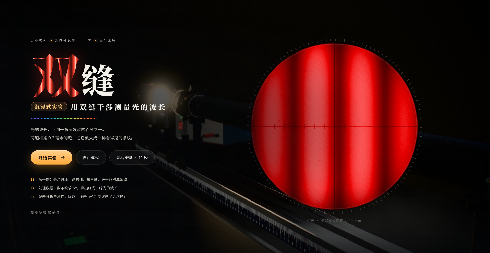 | 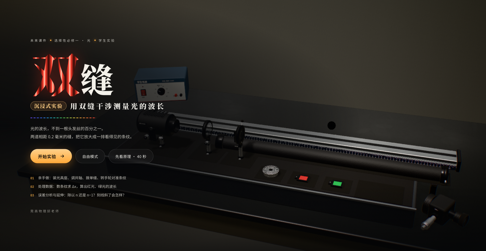 |
| **步骤 2：接通学生电源 12V** | **步骤 3：关灯进入暗室光束效果** |
| 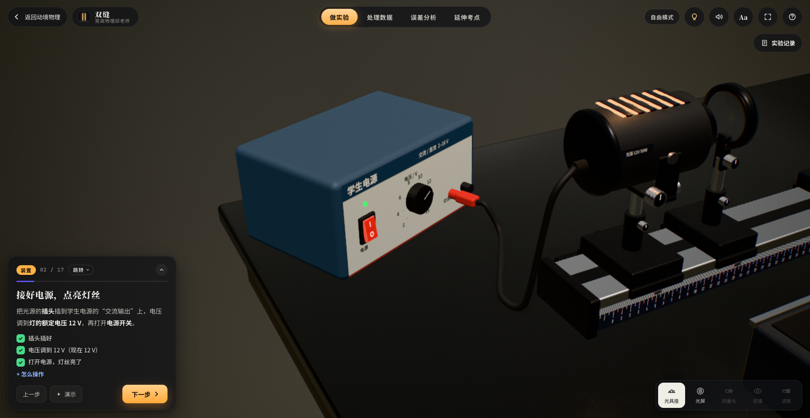 | 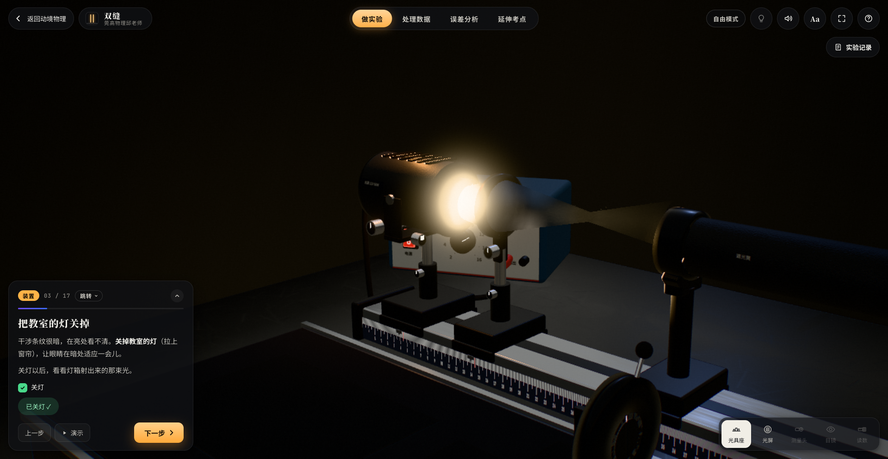 |
| **毛玻璃光屏视角 (Screen View)** | **测量头微调视角 (Head View)** |
|  | 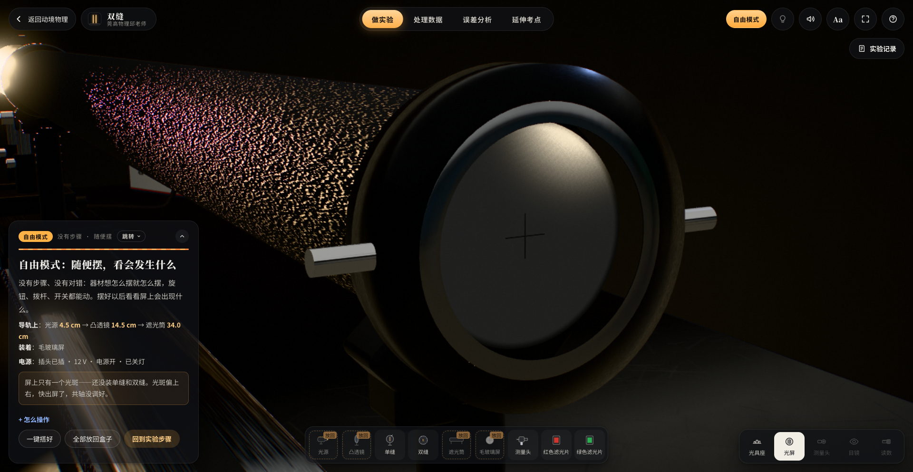 |
| **目镜干涉条纹与分划板 (Eye View)** | **手轮螺旋测微展开读数 (Micro View)** |
| 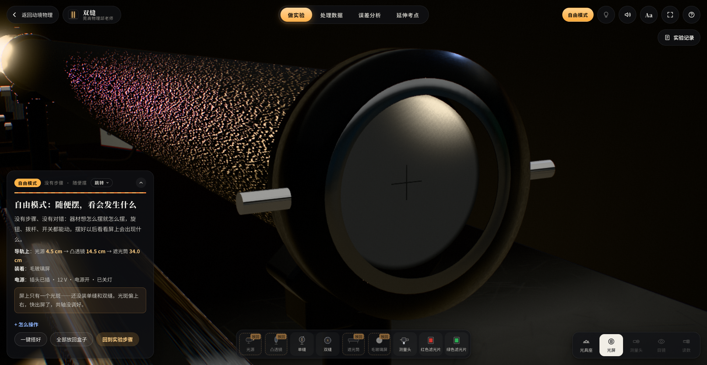 | 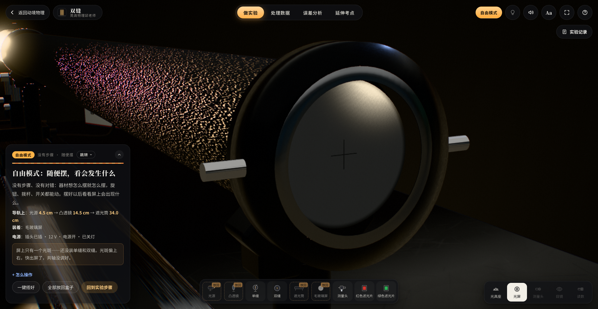 |
| **第二部分：处理数据章节** | **第三部分：误差分析章节** |
| 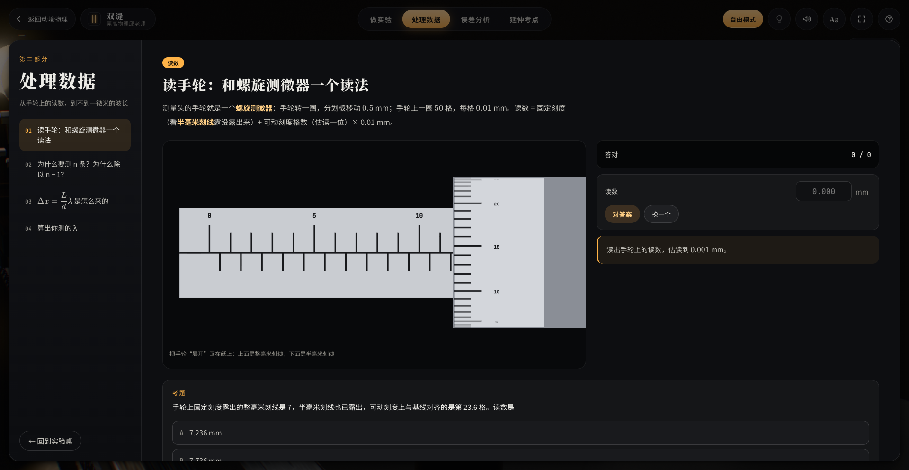 | 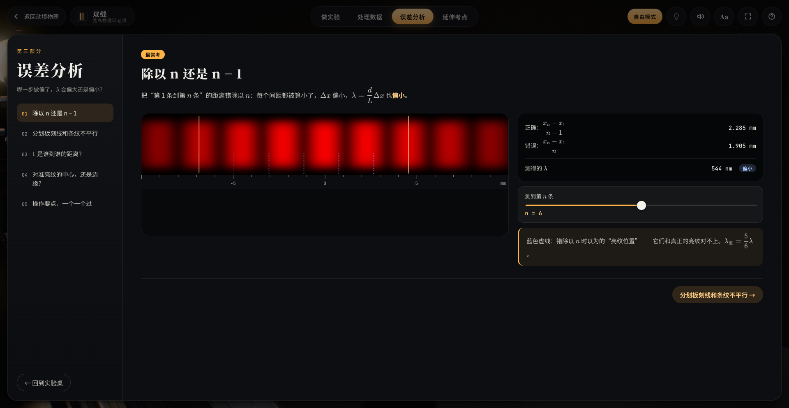 |
| **第四部分：延伸考点章节** | **操作说明弹窗（快捷开启与关闭）** |
| 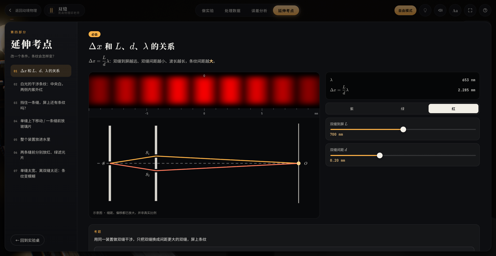 | 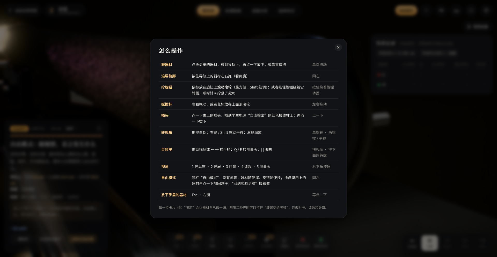 |
| **macOS Safari 真实双击运行实机图 (5.8MB)** | **Safari 目镜视场真实测试实机图 (5.7MB)** |
| 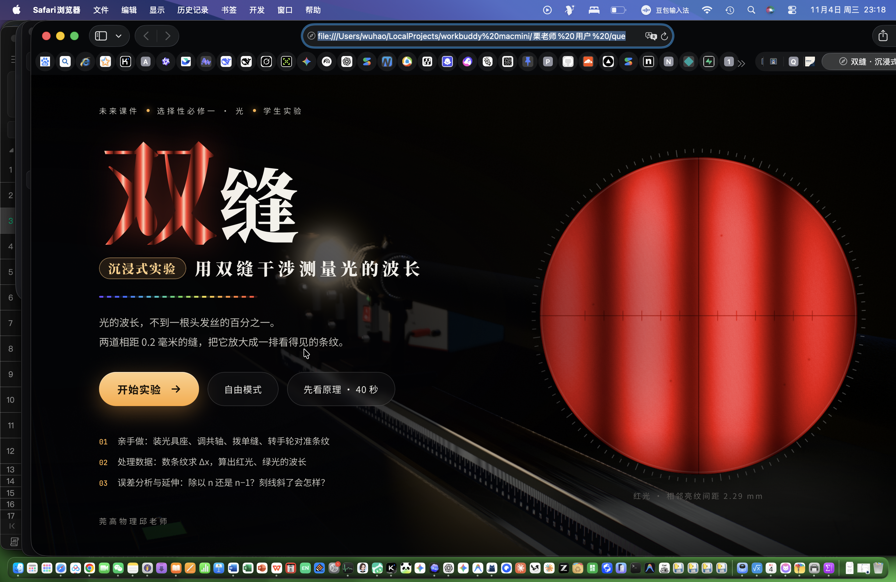 | 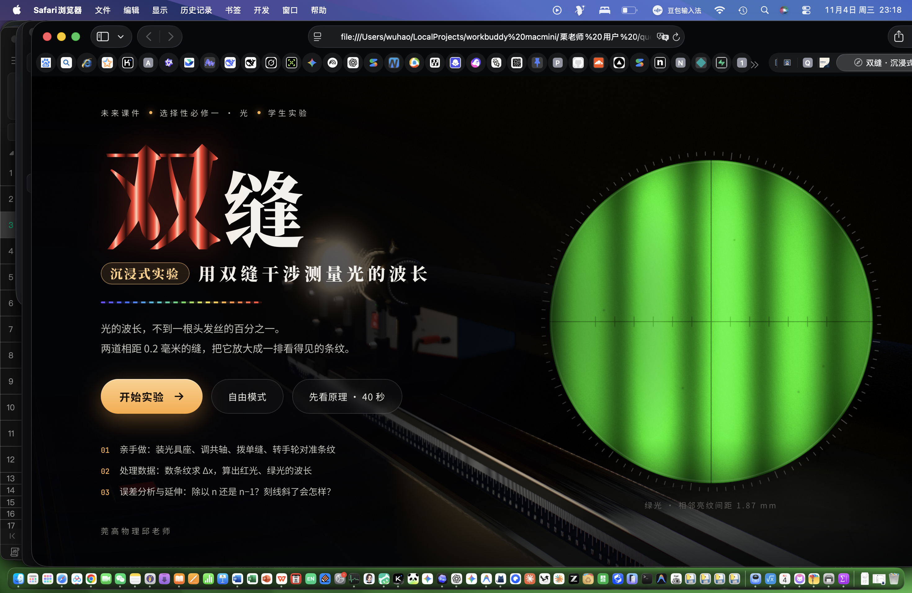 |

---

## 三、 运行方式

### 1. 本地双击直接运行（最推荐，零依赖）
在 macOS Finder 中，进入本工程目录：
- **直接双击 `index.html`**，macOS 默认将使用 Safari 打开；
- 协议为 `file:///.../index.html`；
- **完全断网离线可用，无需安装 Node.js，无需启动本地 HTTP 服务器，无弹窗遮挡！**

### 2. 通过本地静态服务器运行（可选）
```bash
# 进入工程目录
cd questionscope-double-slit-recovered

# 使用 Python 启动本地预览
python3 -m http.server 8080

# 或使用 npx serve
npx serve .
```
在浏览器中访问 `http://localhost:8080` 即可。

---

## 四、 键盘快捷键一览

| 按键 | 功能说明 |
| :---: | :--- |
| **`1`** | 切换到**光具座整体视角**（观察全套装置布局与导轨刻度） |
| **`2`** | 切换到**毛玻璃光屏视角**（观察光斑中心与初级干涉条纹） |
| **`3`** | 切换到**目镜视角**（凑近目镜观察条纹与分划板刻线） |
| **`4`** | 切换到**手轮读数视角**（放大观察固定主尺与可动微分筒） |
| **`5`** | 切换到**测量头视角**（在测量头上旋转目镜与手轮） |
| **`←` / `→`** | 转动手轮移动分划板（按住 **`Shift`** 慢速微调） |
| **`Q` / `E`** | 转动测量头外壳，使分划板竖直刻线与条纹平行 |
| **`[` / `]`** | 调节目镜调焦环（消除视差，调清十字线与条纹） |
| **`L`** | 开关教室日光灯（亮室 / 暗室环境切换） |
| **`M`** | 静音 / 开启音效（旋钮阻尼声、电门声、滑动声） |
| **`Aa`** | 切换投影大字模式（黑板与多媒体投影优化） |
| **`F`** | 全屏显示切换 |
| **`H`** | 打开 / 关闭“怎么操作”帮助说明卡片 |
| **`Esc`** | 离开目镜视角 / 放下手里的器材 / 关闭弹窗 |

---

## 五、 项目结构与核心文档索引

```
questionscope-double-slit-recovered/
├── index.html                   # 核心交付物：零依赖、自包含、支持 Safari 双击直接运行
├── README.md                    # 本文档：项目说明、出处声明、多视角截图与运行指南
├── PHYSICS_MODEL.md             # 物理模型：光程差推导、干涉公式、单缝衍射包络、相干性与误差理论
├── SOURCE_INVESTIGATION.md      # 技术调查报告：原网页架构解构、租约心跳分析与公开开源追溯
├── REPLICATION_REPORT.md        # 复刻对照报告：原网页功能、独立复刻功能与优化对比清单
├── TEST_REPORT.md               # 测试报告：真实 Safari 测试、10 项物理规律验证与 17 阶段截图记录
├── screenshots/                 # 17 张全流程实机截图与真实 Safari 截屏存档 (无压缩高清)
├── src/                         # 解耦重构的工程源码目录
│   ├── physics/
│   │   ├── constants.js         # 光学参数、滤光片、波长与光具座几何常数
│   │   └── engine.js            # 干涉条纹、单缝衍射包络、空间相干度与波长计算核心
│   ├── components/
│   │   └── handwheel.js         # 螺旋测微器读数模型、半毫米判别与估读检验
│   ├── chapters/
│   │   ├── data_processing.js   # 处理数据章节配置、专题讲解与考点题库
│   │   ├── error_analysis.js    # 误差分析章节配置、4大系统/偶然误差解析与测验
│   │   └── extension_more.js    # 延伸考点章节配置、白光、单缝衍射、水介质拓展
│   └── steps/
│       └── lab_steps.js         # 实验 11 步操作指引、检查条件与自动演示逻辑
└── tests/                       # 自动化测试套件
    └── physics_model_test.js    # 10 项核心物理规律科学性自动化测试脚本
```
